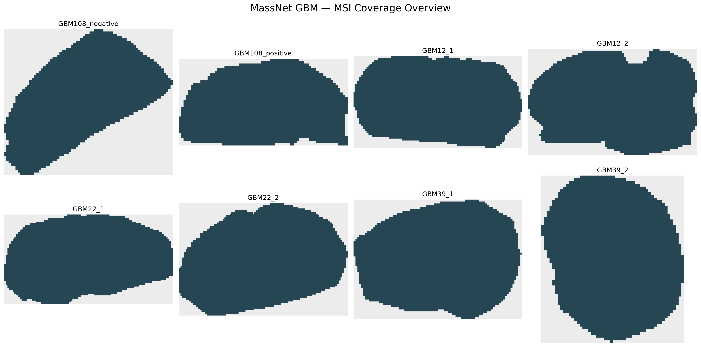
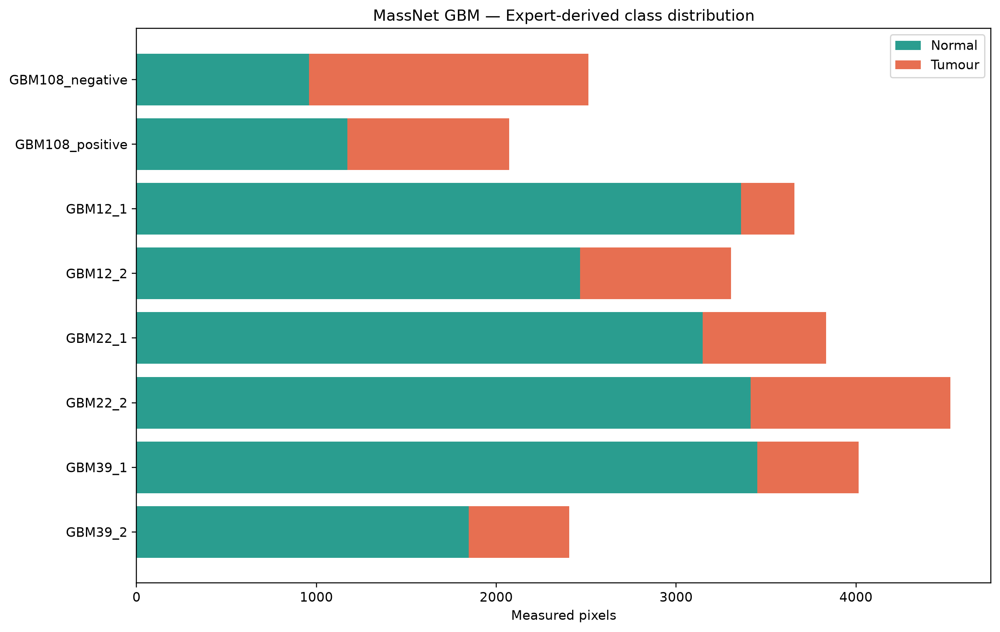
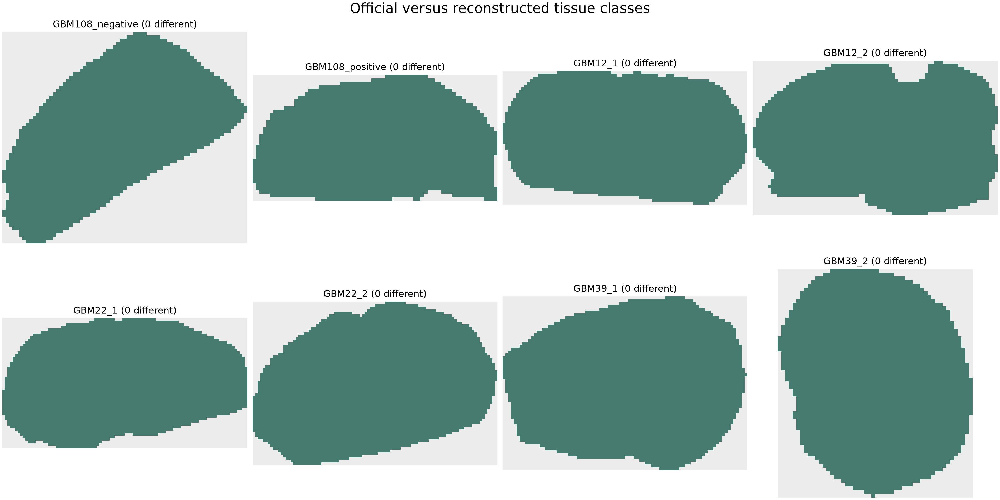
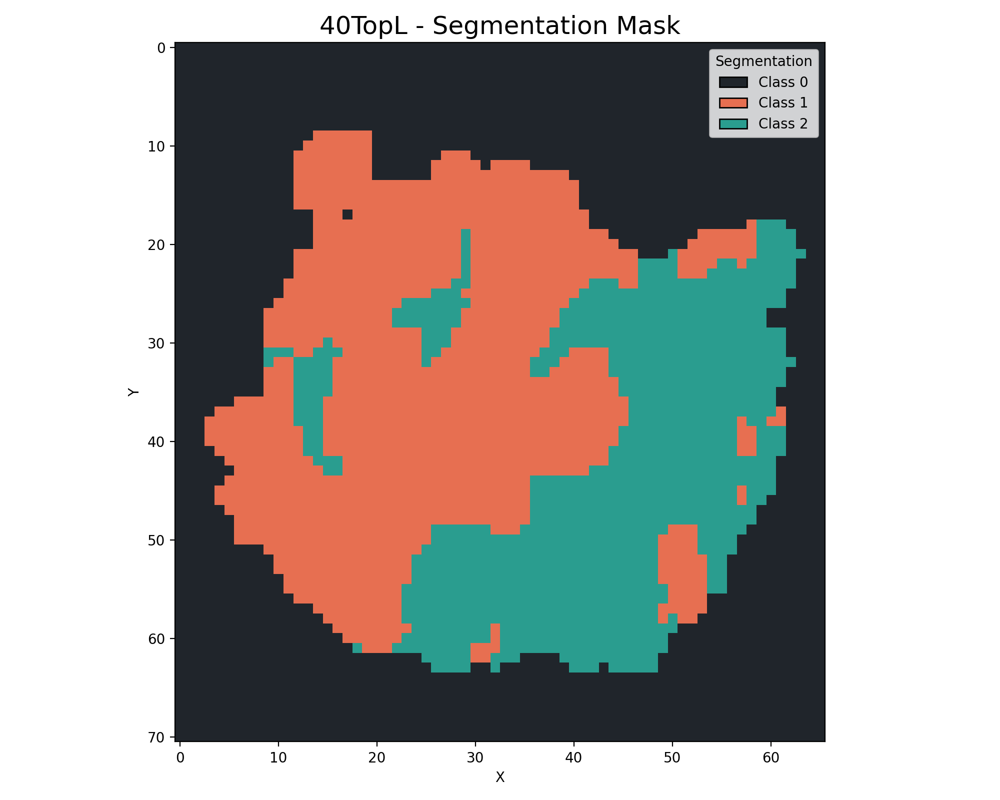

# Datasets and Preprocessing

## MassNet GBM

### Sections

| Section | Shape (y × x) | Measured pixels | Coverage | Normal | Tumour |
|---|---:|---:|---:|---:|---:|
| GBM108_negative | 63 × 73 | 2,512 | 54.62% | 960 | 1,552 |
| GBM108_positive | 36 × 70 | 2,071 | 82.18% | 1,173 | 898 |
| GBM12_1 | 49 × 90 | 3,658 | 82.95% | 3,362 | 296 |
| GBM12_2 | 51 × 81 | 3,306 | 80.03% | 2,466 | 840 |
| GBM22_1 | 51 × 96 | 3,835 | 78.33% | 3,147 | 688 |
| GBM22_2 | 64 × 96 | 4,524 | 73.63% | 3,415 | 1,109 |
| GBM39_1 | 61 × 86 | 4,015 | 76.53% | 3,451 | 564 |
| GBM39_2 | 61 × 52 | 2,406 | 75.85% | 1,848 | 558 |

All sections use the same 85,062-bin m/z axis. `Class_Label` contains expert
pathologist H&E annotations transferred to measured MSI coordinates.





### Mask construction

The HDF5 files provide measured coordinates and class labels. A dense display
mask is created by placing each class at its `(x, y)` position while retaining a
separate coverage mask. Unmeasured grid positions are neither normal nor tumour.

This separation is essential. Treating unmeasured background as a biological
class would corrupt PCC labels, spatial neighbourhoods and accuracy measures.

### Official imzML validation

The separately acquired official imzML dataset used mask values `0=background`,
`1=normal`, `2=tumour`. The HDF5-derived representation used coverage plus
`0=normal`, `1=tumour`. After translating encodings, all measured pixels agreed
semantically in all eight sections.



## CAC

### Sections

| Section | Image shape | Measured spectra | Coverage | Spectral bins |
|---|---:|---:|---:|---:|
| 40TopL | 66 × 71 | 4,686 | 100% | 1,481 |
| 160TopL | 69 × 69 | 4,761 | 100% | 1,481 |
| 200TopL | 67 × 59 | 3,953 | 100% | 1,481 |
| 240TopL | 70 × 67 | 4,690 | 100% | 1,481 |
| 280TopL | 67 × 69 | 4,160 | 89.98% | 1,481 |
| 360TopL | 71 × 64 | 4,544 | 100% | 1,481 |
| 400TopL | 76 × 62 | 4,712 | 100% | 1,481 |
| 520TopL | 69 × 47 | 3,243 | 100% | 1,481 |

The m/z range is approximately 198.03–1060.68. The masks have three classes.
The biological class names must be taken from the dataset documentation; the
code preserves numeric classes rather than inventing names.



### The 280TopL exception

`280TopL` initially exposed an assumption that mask shape and measured
coordinate extent would always match. Its partial coverage means the dense mask
contains locations without spectra. The adapter was corrected to align classes
at measured coordinates instead of reshaping spectra as a full rectangle.

This explains why the section could take longer or fail under dense-grid logic,
but partial coverage itself is not evidence of bad data.

## HDF5 orientation

The loaders accept either:

```text
(pixels, m/z bins)
```

or:

```text
(m/z bins, pixels)
```

They infer orientation using coordinate and m/z lengths. They also require a
strictly increasing m/z axis and unique positive coordinates.

## TIC normalisation

For every measured spectrum:

```text
x_normalised = x / sum(x)
```

Zero-total spectra remain zero. Negative and non-finite intensities are rejected.
Neighbour spectra are normalised individually before aggregation, and the final
context spectrum is normalised again.

## Spatial neighbourhood construction

Coordinates are one-based. For each centre, the code looks up the eight Moore
offsets. A slot contains the neighbouring pixel index only if that coordinate
was measured. This makes edge pixels and holes safe without padding them with
fake tissue measurements.

## Data locations

Raw data and archives remain outside Git:

```text
/datasets/zsuliman/msi_data/cac/
/datasets/zsuliman/msi_data/cac_msipl/
/datasets/zsuliman/msi_data/gbm_massnet/
/datasets/zsuliman/msi_data/zips/
```

Only adapters, compact summaries, masks where appropriate, metrics and figures
belong in the repository.

## RCC (added 16 October)

| Property | Value |
|---|---|
| Tissue | Human renal cell carcinoma; 8 matched pairs (cancer + normal tissue on one slide per pair) |
| Runs used | `MH0204_33`, `UH0505_12`, `UH0710_33`, `UH9610_15`, `UH9812_03`, `UH9905_18`, `UH9911_05`, `UH9912_01` (one run per subject) |
| Size | 16,000 pixels in total over the 8 runs; 972–3,564 measured pixels per run; 10,200 m/z bins, m/z 150.08–1000 |
| Labels | Cardinal `diagnosis`: cancer, normal, NA. NA is kept as a third class `unannotated` (45–78% of pixels per run). The Cardinal vignette drops NA as background (`rcc_nobg`); we did not verify that reading independently |
| GMM K | 3 |
| Budget | Released S3PL `num_GT_peaks` (equals our reference-set size at PCC 0.5) |
| Notes | The dataset documentation says UH0505_12 and UH9905_18 contain heterogeneous tumour with large normal-looking areas |

Exported HDF5s: `/datasets/zsuliman/msi_data/rcc_cardinal/` (`scripts/rcc_feasibility_export.R`, `rcc_env`: R 4.5.3, Cardinal 3.12.1, CardinalIO 1.8.0).

## Sources, access and acquisition (all three collections)

This follows Weigand et al. (S3PL, arXiv:2603.10487v1, Section 3.1 and Table 2), which uses the same three collections plus a fourth (GIST) that we did not use. S3PL code: https://github.com/CeMOS-IS/S3PL (we use v1.0.0, commit `660e3d9`).

| | GBM | CAC | RCC |
|---|---|---|---|
| Tissue | Mouse PDX glioblastoma; 8 sections from 4 PDX lines (GBM12, GBM22, GBM39, GBM108) | Human colorectal adenocarcinoma; 8 of 52 serial sections from **one** tumour | Human renal cell carcinoma; 8 matched cancer/normal pairs |
| Instrument (S3PL text) | MALDI, 9.4 T SolariX FT-ICR | DESI, Thermo Fisher Exactive, negative mode | DESI, Thermo Finnigan LTQ ion trap, negative mode |
| Instrument conflicts to note | — | MetaboLights/OmicsDI record lists **LTQ Orbitrap XL ETD**; S3PL text says Exactive. Cite the original paper's description | S3PL Table 2 says "Thermo LTQ Orbitrap"; its text says LTQ ion trap. Use Dill et al.'s description |
| Repository | NIH Metabolomics Workbench (NMDR), project **PR001292** | MetaboLights **MTBLS415**: https://www.ebi.ac.uk/metabolights/MTBLS415 (profile and centroid imzML, H&E images) | Bioconductor data package **CardinalWorkflows** (`rcc` dataset): https://bioconductor.org/packages/CardinalWorkflows |
| Original publication | Abdelmoula et al., MassNet, *Bioinformatics* 38(7), 2022, doi:10.1093/bioinformatics/btac032 | Inglese et al., "Deep learning and 3D-DESI imaging reveal the hidden metabolic heterogeneity of cancer", *Chemical Science* 8(5), 2017 | Dill et al., DESI imaging of renal cell carcinoma (lipid profiles), *Anal. Bioanal. Chem.*, 2010 — **verify exact reference against the CardinalWorkflows `rcc-data.Rd`** |
| How we obtained it | MassNet-format HDF5 (85,062 bins, `Class_Label` = pathologist H&E annotation); validated against the official imzML archive `zips/gbm_data.zip` (SHA-256 `a69a4246…097f`, `slurm_jobs/extract_s3pl_gbm_imzml.sh`) — all measured pixels agree | imzML from MTBLS415 → audited HDF5 adapters (`/datasets/zsuliman/msi_data/cac/`, `cac_msipl/`); masks/class numbers as released with S3PL | Source tarball `zips/CardinalWorkflows_1.44.0.tar.gz` (SHA-256 `301a3815…c485`); `rcc.rda` extracted and exported to HDF5 through Cardinal |
| Bins / pixels | 85,062; 2,071–4,524 per section | 1,481; 3,243–4,761 per section | 10,200; 972–3,564 per run |
| Classes (GMM K) | normal, tumour (2) | 3 numeric classes (names from dataset documentation) (3) | cancer, normal, unannotated (3) |
| Statistical unit | Section (sections of the same PDX line are not independent; PDX-line rows reported) | Section of **one** biopsy (n = 8 is sections, not patients) | Run = subject |

**Still to confirm (Code, on the cluster):** the exact download origin of the GBM MassNet HDF5 files and of the CAC imzML (date, URL, archive name and SHA-256 under `/datasets/zsuliman/msi_data/zips/`), and the RCC citation in `man/rcc-data.Rd`.
